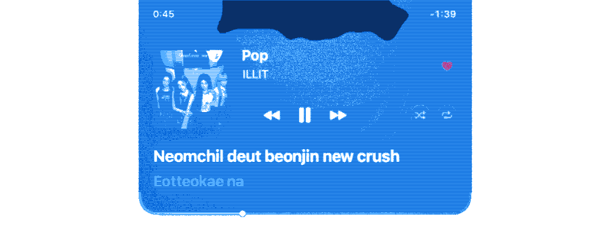
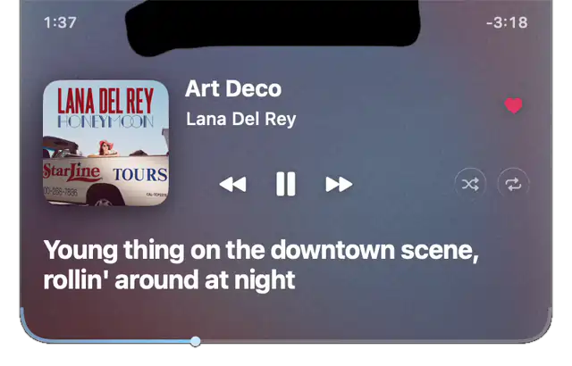

<p align="center">
  <picture>
    <source media="(max-width: 600px) and (prefers-color-scheme: dark)" srcset="docs/banner-phone-dark.webp">
    <source media="(max-width: 600px)" srcset="docs/banner-phone-light.webp">
    <source media="(prefers-color-scheme: dark)" srcset="docs/banner-dark.webp">
    
  </picture>
</p>

<h1 align="center">Magnetite</h1>

<p align="center">Spotify and Apple Music in your MacBook notch, with black ferrofluid that moves to the music.<br>Free and open source.</p>

<p align="center"><a href="https://github.com/scryst/magnetite-releases/releases/latest"><b>Download for Mac</b></a><br>747 KB. Needs macOS 26 on Apple silicon.</p>

<p align="center">
  
</p>

This repository holds the official builds and their checksums. The source, every feature in motion and the FAQ are in [scryst/magnetite](https://github.com/scryst/magnetite); the app's page is [magnetite.app](https://magnetite.app).

## Install or update

Download the ZIP, then open it the first time like this:

1. Open the ZIP, drag Magnetite to Applications, then double-click it.
2. macOS says it can't verify Magnetite. That's expected for a free app that
   isn't in Apple's paid program. Click Done.
3. Open System Settings → Privacy & Security and scroll down to Security. Click
   Open Anyway next to Magnetite, then confirm with Touch ID or your password.
4. Look for the M in the menu bar. Play something in Spotify or Music and hover
   the notch. Allow the two permission prompts: one to control the player, one
   to record system audio for the ink.

You only do this once. The build is ad-hoc signed and not notarized by Apple,
so only open a download you trust.

Prefer to skip the warning? [Inspect the installer](https://github.com/scryst/magnetite/blob/main/install.sh),
then paste this into Terminal (Spotlight → Terminal):

```sh
curl -fsSL https://magnetite.app/install.sh | sh
```

It downloads the release this installer is pinned to (the latest when the site
was last published), checks it against the fingerprint built into the installer
and its code signature, then installs and opens the app. The checksum and
signature confirm the download is intact; Apple hasn't reviewed it. Run it again
to update. The M menu holds settings and Quit.

## Verify a manual download

Put only this release's ZIP and matching `.sha256` file in a fresh folder, open
Terminal in that folder, and run:

```sh
shasum -a 256 -c Magnetite-*.sha256
```

The matching ZIP must report `OK`. Do not install if the checksum fails.

## Help and source

- [Features, requirements, permissions and troubleshooting](https://github.com/scryst/magnetite#readme)
- [Report a bug](https://github.com/scryst/magnetite/issues)
- [Private security reporting](https://github.com/scryst/magnetite-releases/security/policy)
- [Privacy](https://magnetite.app/privacy.html) and [terms](https://magnetite.app/terms.html)
- [Source and MIT license](https://github.com/scryst/magnetite)

No Magnetite account, analytics or audio uploads. Optional Spotify authorization
and artwork requests are described in the privacy notice.
